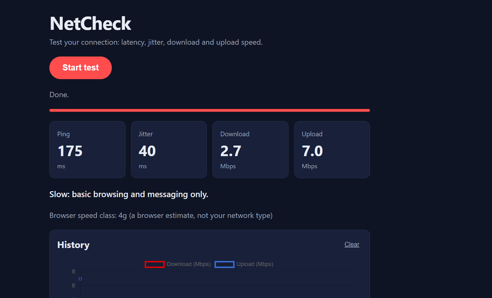

# NetCheck

A browser-based network speed test with its own measurement server.
It measures ping, jitter, download and upload speed, then tells you what your connection can handle.

**[Try it live → rawan237.github.io/netcheck](https://rawan237.github.io/netcheck/)**



---

## Features

- **Four measurements:** ping, jitter, download speed and upload speed
- **A plain-language verdict**, such as *"Good: HD streaming and video calls should be smooth"*
- **Test history** saved in the browser and drawn as a chart
- **Works on phones and desktops**, in light and dark mode

## How the measurements work

| Metric | Method |
| --- | --- |
| **Ping** | 10 small requests to `/ping`. The first is dropped because it includes connection setup; the median of the rest is reported. |
| **Jitter** | The average change between consecutive pings. High jitter makes calls and games stutter. |
| **Download** | 4 downloads of 5 MB from `/download`. The first is a warm-up (TCP slow start); the other 3 are averaged. |
| **Upload** | 3 uploads of 2 MB to `/upload`, averaged. |

Speed in Mbps = bytes × 8 ÷ seconds ÷ 1,000,000

## Architecture

```
 Browser                       AWS EC2 (Ubuntu)
┌──────────────────┐  HTTPS   ┌───────────────────────────────────────┐
│ GitHub Pages     │ ───────▶ │ Caddy (TLS, reverse proxy)            │
│ HTML / CSS / JS  │          │   r-netcheck.duckdns.org → :8001      │
│ Chart.js         │          │        │                              │
│ localStorage     │          │        ▼                              │
└──────────────────┘          │ Docker: FastAPI                       │
                              │   /ping   /download   /upload         │
                              └───────────────────────────────────────┘
```

## Tech stack

| Layer | Tools |
| --- | --- |
| Back end | Python, FastAPI, Uvicorn |
| Front end | JavaScript (`fetch`, `performance.now()`), HTML, CSS, Chart.js |
| Infrastructure | AWS EC2, Docker, Caddy (automatic HTTPS with Let's Encrypt), DuckDNS, GitHub Pages |

## Engineering decisions

- **Random bytes instead of zeros.** Zeros compress well, so a proxy could shrink them and make the connection look faster than it is.
- **No caching.** The server sends `Cache-Control: no-store`, and every request gets a unique query string.
- **Warm-up runs are thrown away.** The first request pays for connection setup and TCP slow start.
- **Size limit.** Downloads are capped at 50 MB so the server cannot be overloaded.
- **CORS restricted** to the site's own address.
- **Honest labels.** The browser's `navigator.connection.effectiveType` reports "4g" for any fast link, including Wi-Fi, so the app shows it as an estimate rather than the network type.

## Limitations

NetCheck uses one connection to one server, so its numbers depend on the distance to that server and on the server's own bandwidth. Commercial tests open many parallel connections to a nearby server, so they usually report higher speeds. Next steps: parallel connections and a choice of test servers.

## Run it locally

**1. Start the server**

```bash
cd backend
python -m venv venv
venv\Scripts\activate          # Windows
# source venv/bin/activate     # macOS / Linux
pip install -r requirements.txt
uvicorn main:app --reload
```

**2. Start the page.** In `docs/app.js`, set `const API = "http://127.0.0.1:8000";`, then:

```bash
cd docs
python -m http.server 5500
```

Open http://localhost:5500.

**Deploying the server**

```bash
cd backend
docker build -t netcheck .
docker run -d --name netcheck --restart unless-stopped -p 127.0.0.1:8001:8001 netcheck
```

Then point a Caddy site block at `localhost:8001`.

## Project structure

```
netcheck/
├── backend/
│   ├── main.py            # FastAPI: /ping, /download, /upload
│   ├── requirements.txt
│   └── Dockerfile
└── docs/                  # served by GitHub Pages
    ├── index.html
    ├── style.css
    └── app.js             # measurements, verdict, history chart
```

---

Built by **Rawan Elhussain** · [github.com/rawan237](https://github.com/rawan237)
